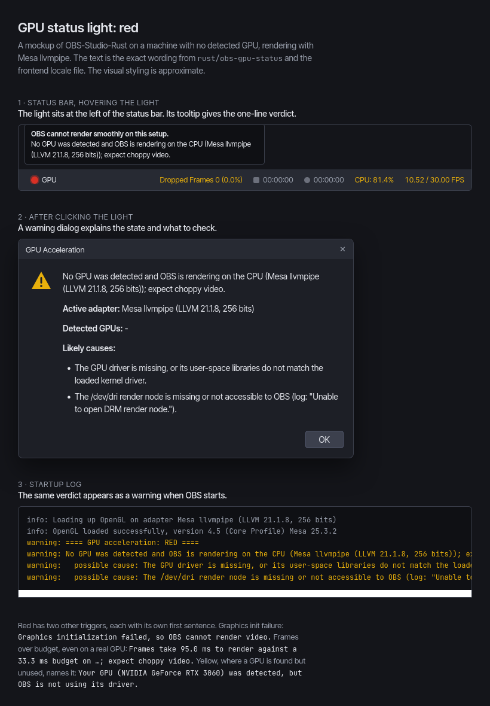

# GPU acceleration status light

OBS-Studio-Rust shows a light in the status bar that says whether video is
rendered on a hardware GPU (obs-rust/obs-studio#846). Clicking it opens a
dialog that explains the state and lists likely causes. The same state is
logged at startup and returned by obs-websocket as `GetStats.gpuAcceleration`.

| Light | Meaning |
|---|---|
| Green | OBS renders on a hardware GPU (any vendor: the driver is bound and the active adapter confirms it). |
| Yellow | No GPU was found and OBS renders in software (llvmpipe, softpipe, Microsoft Basic Render Driver, SwiftShader). Expected on a VM or headless machine. |
| Red | A GPU (NVIDIA, AMD or Intel) is present but OBS renders in software, graphics initialization failed, or frames are over budget. |

**Frame budget.** Once a second the frontend samples libobs' one-second
average frame time (`obs_get_average_frame_time_ns`). The light compares
the **median** of the last 15 samples with the frame interval and ignores
frame timings until it has at least 5 samples, so one slow second (for
example right after launch) does not turn it red (#929). Frames over budget are red.

**Adapter.** The adapter is the renderer OBS actually uses: `GL_VENDOR` and
`GL_RENDERER` on OpenGL, and the active DXGI adapter on Direct3D 11. It is
not `gs_get_device_name()`, which only names the API (`OpenGL`).

An earlier mockup of the dialog for a machine with no GPU (the styling is approximate). Since #1005 that case is yellow, not red; a GPU OBS can't use is red:

## Where it lives

- Classifier, GPU detection (`/sys/class/drm`, `/dev/dri`, `nvidia-smi`), the
  frame window (`FrameStats::from_samples`, `median()`) and the dialog text:
  `rust/obs-gpu-status`.
- Reading the adapter: `ActiveAdapterName()` in
  `frontend/utility/GpuStatus.cpp`, with `GetGlGetStringProc()` in
  `frontend/utility/platform-x11.cpp`, `platform-windows.cpp` and
  `platform-osx.mm`.
- Light and dialog: `frontend/utility/GpuStatus.cpp` and
  `frontend/widgets/OBSBasicStatusBar.cpp`. They are built whenever cargo
  is available, whatever `ENABLE_RUST_LIBOBS` (the app's name) says
  (`frontend/cmake/feature-gpu-status.cmake`, option `ENABLE_GPU_STATUS`).
  A build without cargo, such as the Flatpak sandbox today, configures
  without the light and prints a warning (#946).
- `GetStats.gpuAcceleration`: obs-websocket reads it from the frontend's
  `get_gpu_status` proc, and it is `null` when nothing provides it.
- Tier 4 check (OpenGL forced onto llvmpipe → not green):
  `test/websocket-tier4/run_tier4.py`.
